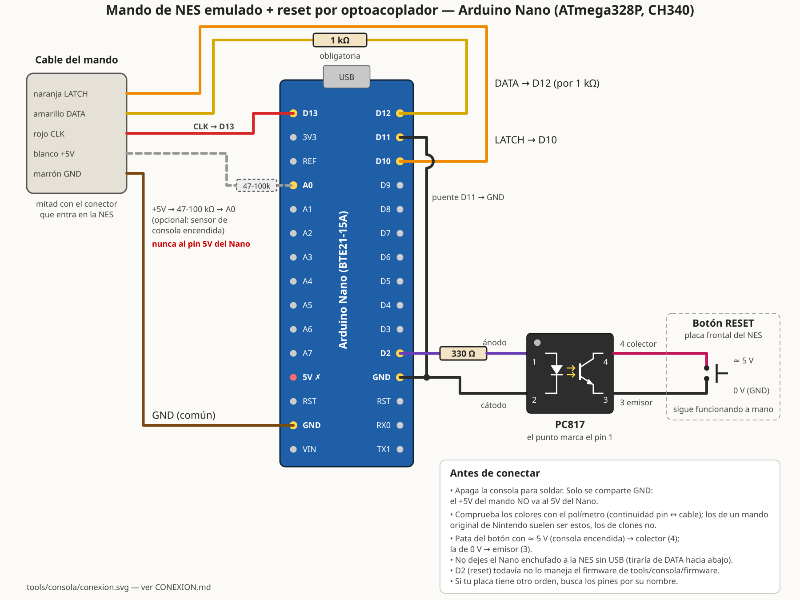

# Conexión del Arduino Nano al puerto de mando del NES / Famicom AV

El Nano hace de **mando 1**. Con el ATmega328P a 5 V no hace falta adaptador de niveles: el puerto del mando
también es de 5 V. El mismo montaje sirve para el **Arduino Uno**, con los mismos números de pin (D10-D13, A0, GND).
Solo cambia el puerto serie: el Uno sale como `/dev/ttyACM0` y el Nano con CH340 como `/dev/ttyUSB0`. Los clones con
un CH340 "CDC" (USB 1a86:8040) también salen como `/dev/ttyACM0`.



Fuente editable: [conexion.svg](conexion.svg) (`rsvg-convert -w 1800 conexion.svg -o conexion.png`).

## Material
- Arduino Nano clásico (ATmega328P, 16 MHz). **No sirven** el Nano 33, el Nano RP2040 Connect ni el Nano ESP32,
  que funcionan a 3,3 V. El Nano Every (ATmega4809) tampoco: su SPI es otro y el firmware no vale.
- **Clones con LGT8F328P** (por ejemplo, la placa "BTE21-15A" con chip LQFP32): sirven. El cargador se presenta como
  un ATmega328P (firma 1e950f, 57600 baudios), pero el chip corre con su oscilador interno de 32 MHz y arranca a
  4 MHz. El firmware lo detecta (registro PMCR en 0xF2) y pone el reloj a 16 MHz; sin eso el PC solo recibía
  basura. Probado el 2026-11-11: 300 órdenes sin errores y reloj medido de 15,93 MHz.
  Su SPI, además, tiene colas (FIFO) de envío que el ATmega no tiene: la interrupción de LATCH las vacía antes de
  escribir el byte (registro SPFR); sin eso la consola leía siempre bytes viejos y los botones no llegaban.
  El PC tampoco debe reiniciar el Nano al abrir el puerto: durante el reinicio el cargador mueve las líneas del mando
  y el menú del N8 deja de leerlo. `serie.py` no baja DTR al cerrar (sin HUPCL), así que solo se reinicia al grabarlo.
- Alargador de mando de NES cortado: se usa **la mitad con el conector macho** (la que entra en la consola).
- 1 resistencia de **1 kΩ** (en DATA; obligatoria).
- Opcional: 1 resistencia de **47-100 kΩ** para que el PC sepa si la consola está encendida (ver abajo).
- Cable USB del Nano al PC.

## Esquema
```
  Puerto de mando 1 (NES / Famicom AV)                         Arduino Nano
  ────────────────────────────────────                         ────────────
  pin 1  GND ───────────────────────────────────────────────── GND
  pin 3  LATCH (OUT, la consola lo sube) ──────────────────────── D10  (PB2 = SS del SPI)
  pin 2  CLK   (la consola lo baja al leer) ───────────────────── D13  (PB5 = SCK del SPI)
  pin 4  DATA  (D0, la consola tiene pull-up) ─────[ 1 kΩ ]────── D12  (PB4 = MISO del SPI)
                                                    puente ─┬──── D11  (PB3 = MOSI)
                                                            └──── GND
  pin 7  +5V ──────── NO SE CONECTA AL 5V DEL NANO (aislarlo con cinta)
             └──[ 47-100 kΩ ]─── A0   (opcional: sensor de consola encendida)
  pines 5 y 6 (D3, D4): sin conectar
```
- **D11 a GND** (un cable de puente en el propio Nano). Así, a partir de la 9.ª lectura el Nano devuelve lo mismo
  que un mando original. Algunos juegos lo comprueban.
- **La resistencia de 1 kΩ en DATA** limita la corriente a ~5 mA si DATA acaba por error en una salida de la consola
  (CLK o LATCH), o si la consola está apagada. Con ella, confundir CLK, LATCH y DATA no rompe nada: simplemente no
  funciona. Con el pull-up de la consola, el nivel bajo queda en ~0,5-0,9 V, por debajo del umbral de 1,35 V del
  74HC368 de la consola.
- **Nunca unir el +5V del puerto con el 5V del Nano.** El Nano se alimenta del USB del PC y la consola de su fuente:
  dos fuentes unidas se pelean. Solo se comparte **GND**.
- El LED "L" del Nano está en D13 (CLK) con su resistencia y brillará un poco. Es normal: carga la línea con ~3 mA,
  que el 74HC368 de la consola da sin problema. En el Uno R3 ese LED va con un amplificador y no carga la línea.

### Pines del Arduino Nano clásico (vista desde arriba, USB arriba)
```
                 ┌───[USB]───┐
  CLK ──── D13   │●         ●│ D12 ──[1 kΩ]── DATA
           3V3   │●         ●│ D11 ── puente a GND
           REF   │●         ●│ D10 ── LATCH
  (sensor) A0    │●         ●│ D9
           A1    │●         ●│ D8
           A2    │●         ●│ D7
           A3    │●         ●│ D6
           A4    │●         ●│ D5
           A5    │●         ●│ D4
           A6    │●         ●│ D3
           A7    │●         ●│ D2 ──[330 Ω]── PC817 pin 1 (reset)
  NO usar  5V    │●         ●│ GND ── GND del puerto (y el puente de D11)
           RST   │●         ●│ RST
  GND ──── GND   │●         ●│ RX0
           VIN   │●         ●│ TX1
                 └───────────┘
```
Los dos GND del Nano están unidos; usa el que quede más cómodo. La serigrafía de la placa manda: si tu clon tiene
otro orden, busca D10, D11, D12, D13, A0 y GND por su nombre.

## Puerto del mando: qué cable es cada señal
Vista de frente del **puerto de la consola**. El lado redondeado queda arriba a la izquierda:
```
         .-
  GND  1 |o\
  CLK  2 |o o\ 7  +5V
  LATCH 3|o o| 6  D3
  DATA 4 |o o| 5  D4
         '---'
```
- En el **conector macho del alargador** el dibujo se ve **en espejo**: la columna de 4 pines queda a la derecha.
- Los colores del alargador chino no siguen ningún estándar. En el mando original son: marrón = GND,
  blanco = +5V, rojo = CLK, naranja = LATCH, amarillo = DATA. **Mide siempre**:
  1. Con el alargador desenchufado, polímetro en continuidad entre cada pin del macho y los cables cortados.
     Apunta el color de GND, CLK, LATCH, DATA y +5V.
  2. Comprobación con la consola encendida, el alargador enchufado y nada en los cables. Mide la tensión de cada
     cable respecto a GND:
     +5V ≈ 5,0 V · LATCH ≈ 0 V (pulsos muy cortos hacia arriba) · CLK ≈ 5 V (pulsos cortos hacia abajo) ·
     DATA ≈ 5 V (pull-up de la consola).
  3. Apaga la consola antes de soldar o conectar el Nano.

## Reset de la consola con optoacoplador (PC817)
El reset del kit Lava (Select+B) solo funciona si el juego lee el mando. Para resetear también un juego colgado, el
Nano "pulsa" el botón RESET del NES a través de un PC817: el LED del opto lo enciende D2 por una resistencia de
330 Ω (≈ 11 mA) y el transistor del opto pone en corto las dos patas del botón, igual que el dedo.
```
       Arduino Nano                     PC817 (DIP-4, vista de arriba)        Botón RESET del NES
       ────────────                     ┌─────────────┐                       (placa frontal)
                                        │ ●           │
  D2  ───[ 330 Ω ]───────────────── 1 ──┤ ánodo  colec├── 4 ──────────────── pata "caliente" (≈ 5 V)
                                        │   ▶|    ⟋   │                         │
  GND ───────────────────────────── 2 ──┤ cátodo emis.├── 3 ──────────────── pata de GND (0 V)
                                        └─────────────┘                         │
                                                                             [botón]  (queda en paralelo)
```
- **Pines del PC817:** el punto marca el pin 1. 1 = ánodo, 2 = cátodo (lado del LED, va al Nano); 3 = emisor,
  4 = colector (lado del transistor, va al botón).
- **Cuál pata del botón es cuál:** consola encendida, polímetro en tensión con la punta negra en GND (el blindaje o
  el pin 1 del puerto de mando). La pata con ≈ 5 V va al **colector (4)**; la de 0 V, al **emisor (3)**. Si las dos
  marcan 0 V, mira la otra pareja de patas del pulsador (los de 4 patas van unidos de dos en dos). Al revés no se
  rompe nada, pero el reset no funciona.
- Suelda dos cables finos a las patas del botón, sin quitarlo: el botón sigue funcionando a mano.
- El Nano y la consola ya comparten GND por el cable del mando; el opto no hace falta para aislar, pero evita que
  un fallo del Nano o el arranque de su cargador (todos los pines en entrada) toquen la línea de reset.
- **Firmware:** el pin D2 aún no lo maneja el firmware de `firmware/`; hasta que se añada, el reset sigue siendo
  el del kit Lava.

## Sensor de encendido (opcional, recomendado)
Une el +5V del puerto con **A0** a través de una resistencia de 47-100 kΩ. No es una alimentación: la resistencia
deja pasar menos de 0,1 mA. Con esto, `prueba.py` sabe si la consola está encendida. Cuando un juego se cuelga y
el reset con Select+B no funciona, te pide que apagues y enciendas, y **detecta solo** cuándo lo has hecho para
seguir con el siguiente juego. Actívalo con `--sensor-5v` (o `"sensor_5v": true` en `config.json`).

## Cómo funciona (resumen del firmware)
El mando original es un registro de desplazamiento CD4021:
1. Mientras LATCH está alto, carga los 8 botones.
2. Cuando LATCH baja, DATA muestra el botón A.
3. En cada **subida** de CLK pasa al bit siguiente: A, B, Select, Start, Arriba, Abajo, Izquierda, Derecha.
4. Nivel bajo = pulsado.

El ATmega328P tiene un SPI en modo esclavo que hace exactamente eso por hardware:
- LATCH va a SS, CLK a SCK y DATA sale por MISO.
- Modo 2 (CPOL=1, CPHA=0) y el bit menos significativo primero.
- SS bajo pone el bit A en MISO, y cada subida de SCK saca el siguiente sin intervención del programa.

El programa solo prepara el byte de cada fotograma:
- Una interrupción en la subida de LATCH (PCINT en D10) copia el byte a `SPDR`. Tarda ≤ 1,3 µs, y el pulso de
  LATCH más corto que se ve en juegos dura ~2,2 µs (dos `STA $4016` seguidos).
- No hay ninguna otra interrupción: el puerto serie y el temporizador se atienden por sondeo para no retrasarla.

Los fotogramas se cuentan con los LATCH:
- Un LATCH que llega al menos medio fotograma después del anterior empieza un fotograma nuevo.
- Si el juego deja de leer el mando unos fotogramas, el Nano los cuenta por tiempo (periodo NTSC medido de los
  propios LATCH, ~16,64 ms).
- Así el número de fotograma coincide con el del banco (`run_test.lua`) aunque el juego lea el mando dos veces por
  fotograma o tenga fotogramas de carga.
- Con la consola apagada o sin lecturas durante 0,5 s, MISO pasa a alta impedancia.

## Precauciones
- No dejes el Nano conectado a la consola **sin USB**. Sin alimentación, sus diodos de protección tiran de DATA
  hacia abajo y la consola puede leer botones pulsados.
- El Nano se reinicia cada vez que el PC abre el puerto serie (DTR). `mando.py` espera su saludo; no hay que hacer
  nada.
- El kit Lava RGB resetea la consola manteniendo Select+B 3-4 s, pero solo si el juego está leyendo el mando: el kit
  lo ve en las mismas líneas. Si el juego está colgado y no lee, el reset no llega y hay que apagar a mano.
